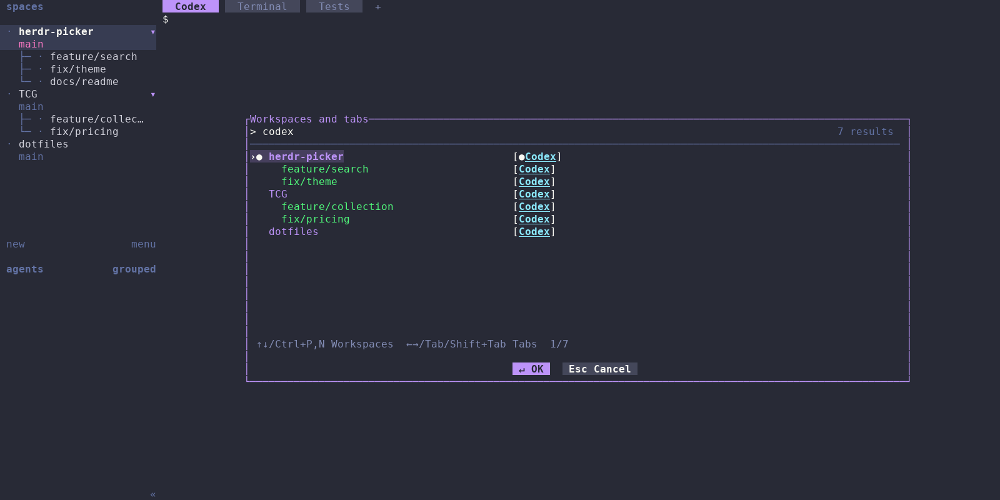

# herdr-picker

A small, on-demand Rust plugin that fuzzy-finds **open Herdr workspaces, worktrees, and tabs**. Type immediately, move with the keyboard, and press Enter to focus a destination. Opened worktrees are nested beneath their root workspace. Nothing is created or closed.



Captured from a real, isolated Herdr session with three projects, five linked
worktrees, and fifteen tabs. The prefilled `codex` query highlights matching
destinations and retains their workspace and worktree context.

Herdr's built-in sidebar and navigation keys move through its existing UI. This plugin adds one searchable palette containing selectable workspace rows and individual tab destinations, including matching across both names.

**Current limits:** Herdr 0.9.5 popups are centered, and its snapshot does not contain MRU history. This release orders the group containing the current workspace first, followed by Herdr's root workspace UI order, and initially selects the first other workspace. It cannot promise `Cmd+P → Enter` returns to the previously visited workspace. Branch labels are omitted. These differences, the alternatives investigated, and source references are detailed in [API feasibility](docs/api-research.md).

## Requirements and installation

- Herdr **0.9.5 or later** (0.9.5 is the tested API baseline).
- macOS or Linux, with a UTF-8 terminal.
- Stable Rust and Cargo (Rust 1.88 minimum for this source release).
- Git for installation from GitHub. No daemon, Node, or Python runtime is needed by the plugin.

### Install from GitHub (recommended)

Run on each machine:

```sh
herdr plugin install kamaal111/herdr-picker
herdr plugin action invoke herdr-picker.open
```

Herdr manages its own checkout and runs the manifest's locked Cargo release build. You do not need to clone this repository or keep a development checkout on each machine. Git and Rust/Cargo are required on each machine because installation builds from source. Review the installation preview as with any executable plugin.

After confirming the action works, add a [launch shortcut](#launch-shortcut). Search mode defaults to hierarchical without creating a plugin config file.

### Update an installed plugin

After new changes reach this repository's `main` branch, run on each machine:

```sh
herdr plugin update herdr-picker
```

Herdr updates its managed checkout and rebuilds the plugin. No manual `git pull` or build command is needed. Updates are requested per machine; they do not synchronize automatically. These installation commands follow `main`, so maintainers publish updates by pushing tested changes there; a GitHub Release or package registry is not required.

### Switch from a local link

If you previously used `herdr plugin link`, unlink it before installing from GitHub:

```sh
herdr plugin unlink herdr-picker
herdr plugin install kamaal111/herdr-picker
herdr plugin action invoke herdr-picker.open
```

Unlinking leaves your source directory intact. Keep your existing `herdr-picker.open` keyboard shortcut; the action ID stays the same. After switching, Herdr launches the plugin from its managed checkout, so the old source directory is no longer required for running it.

### Open the pane directly

To open the pane entrypoint directly:

```sh
herdr plugin pane open --plugin herdr-picker --entrypoint picker
```

### Link a source directory for development

Install Herdr 0.9.5 or newer and stable Rust/Cargo, then obtain the project source by cloning the repository or extracting a source archive. The source must include `Cargo.lock`, `Cargo.toml`, `rust-toolchain.toml`, `herdr-plugin.toml`, and `src/`. Build locally so the executable matches your OS and CPU; an existing `target/` directory is not needed.

Start or attach to a Herdr session, then run from the project directory:

```sh
cd /path/to/herdr-picker
cargo build --release --locked
herdr plugin link "$PWD"
./target/release/herdr-picker check
herdr plugin action invoke herdr-picker.open
```

`plugin link` registers the plugin globally for the current user but does not run build commands or edit keyboard shortcuts. Rebuild after source changes. The `check` command validates discovery without changing focus. The final command opens the picker; press Escape to dismiss it or select a destination with Enter. Keep the project directory at that location while linked, because Herdr launches the executable from it. To unregister the local plugin without deleting its files, run `herdr plugin unlink herdr-picker`.

After confirming the action works, add a launch shortcut using the next section. Search mode defaults to hierarchical without creating a plugin config file. The [automated verification commands](#development) exercise discovery, popup launch, and destination focus in isolated sessions.

## Launch shortcut

Add the following to your existing Herdr configuration (normally `~/.config/herdr/config.toml`; respect `HERDR_CONFIG_PATH` if set):

```toml
[[keys.command]]
key = "cmd+p"
type = "plugin_action"
command = "herdr-picker.open"
description = "Search workspaces, worktrees and tabs"
```

`cmd+p` is the desired default binding, supplied as an example because plugins cannot register a default shortcut in their manifest. Herdr owns the shortcut; there is no redundant `shortcut` field in the plugin's config. Change `key` to configure it. Remove any conflicting binding for the same chord. Reload with `herdr server reload-config` where supported, or reattach Herdr to load the config.

A reliable fallback is your Herdr prefix followed by `f`:

```toml
[[keys.command]]
key = "prefix+f"
type = "plugin_action"
command = "herdr-picker.open"
description = "Search workspaces, worktrees and tabs"
```

Use Herdr's configured prefix (the factory default is `Ctrl+B`), then `f`. If your terminal intercepts Cmd+P, use this fallback or choose another Herdr shortcut. Terminal configuration changes are not part of the normal installation.

## Search modes

The plugin config lives in Herdr's supported per-plugin config directory:

```sh
herdr plugin config-dir herdr-picker
```

Create `config.toml` inside the printed directory:

```toml
search_mode = "hierarchical"
```

`hierarchical` is the default if the file or setting is absent. Opened linked worktrees are nested beneath their root workspace. Each workspace/worktree occupies one row, with its matching tabs displayed horizontally to its right. A root name match includes its worktrees and tabs; a worktree name match includes its tabs and selectable root; a tab match includes its selectable ancestors. Workspaces and worktrees keep Herdr's UI order during filtering; tabs always keep Herdr tab order.

Set `search_mode = "flat"` for workspace rows with ancestor breadcrumbs such as `herdr-picker / multimachine`, followed by their matching tabs. Nonempty searches rank each row by its best workspace/tab match, with stable ties in workspace order; empty searches use hierarchical workspace order. Matching tabs always retain their owning workspace. The displayed result count counts workspace/worktree rows, including selectable ancestors in hierarchical mode.

Workspaces and worktrees show their matching tabs in the right-hand strip even when they have only one tab. The workspace and its tabs count as one result. Enter on the workspace restores its remembered tab and pane; selecting a tab focuses that tab explicitly. Cycling a sole matching tab keeps it selected.

Matching ignores case, supports noncontiguous characters, and requires **every whitespace-separated term** to match a workspace, worktree, or tab name. Each term can match within one name or span hierarchy labels in parent-to-child order without spaces. `pickercodex` and `color codex` both find the Codex tab beside ColorPicker. Separate terms can match different levels in any order. Matches within a single name retain their existing scoring and highlighting preference. `color` can also match the Claude Code tab beside ColorPicker because `cod` genuinely matches “Code.” No branches, paths, panes, agent metadata, or unopened worktrees participate. Full names stay searchable after visual truncation.

Worktrees are grouped by the snapshot's repository key, not their names or checkout paths. A renamed root still owns its worktrees. If the root workspace is closed, provenance is incomplete, or multiple open roots share the key, worktrees remain standalone destinations. Nothing is opened to create a parent row.

For example, with one tab in each worktree:

```text
herdr-picker                      [1] [2]
  multimachine                    [1]
  skip-showing-tab-if-1-tab        [1]
  just                            [1]
  worktree-hirarchy                [1]
```

If `multimachine` has multiple tabs, those tabs appear to its right on the same row. `herdr-picker multimachine codex` finds its Codex tab and retains both ancestors in hierarchical mode. The active group appears first, other groups follow root workspace number order, and siblings keep workspace number order. The active marker stays on the actual focused destination, even when its root appears first.

Changing the query immediately selects the first workspace/worktree result in the current mode's ordering. Searching never switches automatically. Clearing the query selects the first workspace/worktree result too; only a newly opened picker uses the initial other-workspace selection.

## Controls

| Input | Action |
| --- | --- |
| Typing / paste | Filter immediately |
| ↑ / Ctrl+P | Previous workspace or worktree |
| ↓ / Ctrl+N | Next workspace or worktree |
| → / Tab | First or next matching tab, wrapping after the last |
| ← / Shift+Tab | Previous matching tab, wrapping before the first; from a workspace, select its last matching tab |
| Enter / click ↵ OK | Focus selected workspace or tab and exit |
| Esc / Ctrl+C / click Esc Cancel | Exit without switching |
| Left click | Focus clicked result and exit |
| Mouse wheel | Move selection and scroll results |

Vertical navigation stops at workspace boundaries. Moving up/down selects the destination workspace and clears tab selection; a boundary press leaves selection unchanged. Left/right and Tab/Shift+Tab cycle only through matching tabs in their workspace, without selecting the workspace itself. When tabs exceed the available width, the strip shifts to keep the selected tab readable, with `◀`/`▶` marking hidden tabs. Click a workspace label or tab to activate it; gaps and overflow indicators do nothing. The mouse wheel moves between workspace rows and clears tab selection.

Empty results show “No matching results”; Enter does nothing. Every invocation starts with an empty query. `●` marks the currently active workspace/tab; `›` marks workspace selection and the theme background keeps the workspace highlighted together with its selected tab. Matches are bold and underlined, including on selected destinations. Labels stay on one line and truncate with `…`.


The centered popup is 80% wide and at most 22 outer rows, clamped by Herdr to the terminal size. All results remain reachable by scrolling. The terminal UI responds to resize; extremely small areas retain Escape guidance. It requests terminal mouse reporting; Herdr 0.9.5 source forwards popup mouse events. Enable Herdr's mouse capture if the outer terminal otherwise handles clicks.

## Theme and footer buttons

The picker reads Herdr's saved theme configuration on each opening. It follows
`HERDR_CONFIG_PATH`, then `XDG_CONFIG_HOME/herdr/config.toml`, then
`~/.config/herdr/config.toml`. No picker theme configuration is needed.

Root workspace names use the theme accent, worktree names use green, and tab
names use blue, including breadcrumbs and horizontal tabs. With Dracula these
are purple (`#BD93F9`), green (`#50FA7B`), and cyan (`#8BE9FD`). Custom token
overrides apply to these colors too. Selected results retain their type
colors over the theme selection background.

All Herdr 0.9.5 built-in themes, aliases, `[theme.custom]` colors, and legacy
`ui.accent` overrides are supported. The panel, text, selection, hints, and
buttons use those colors. The bottom-centered buttons have a blank row above them. The `↵ OK`
button performs the same action as Enter; `Esc Cancel` exits without switching. OK is disabled while loading or
when no result is selected. Narrow popups show only Cancel; Enter still works.

With `theme.auto_switch = true`, the picker queries the popup terminal's
light/dark appearance and follows appearance updates while open. It applies
`dark_name` / `light_name` (or Herdr's sibling defaults), followed by shared
custom colors and the active `[theme.custom.dark]` / `[theme.custom.light]`
overrides. Without an appearance report, it uses Herdr's dark fallback and
remains fully interactive. The `terminal` theme preserves default colors.

Saved config changes take effect next time the picker opens. Unsaved Settings
previews are not available to the plugin. Missing config uses Catppuccin;
invalid config/theme names use fallback colors and report a diagnostic.
Palette compatibility is pinned to the inspected Herdr 0.9.5 source; future
Herdr palette changes may require updating the plugin. Outside clicks are
ignored by Herdr 0.9.5; use Cancel to close with the mouse.

## Development

With [Just](https://github.com/casey/just) installed, run `just` to list the available recipes. CI uses Just 1.58.0 and runs the same Rust and PTY verification workflow on macOS and Linux:

```sh
just ready
```

Use `just quality` for formatting and lint checks, `just test` for Rust tests, or `just test-pty` to build and smoke test the release binary. `just format` (alias `just fmt`) formats Rust code; `just format-check` (alias `just fmt-c`) checks it. `just ready` and `just test-pty` require Python 3.

For local plugin development with Herdr installed:

```sh
just plugin-link
just plugin-check
just plugin-open
```

`plugin-link` builds and registers this checkout globally for the current user. `plugin-check` validates a live snapshot without changing focus. `plugin-open` rebuilds and opens the already linked plugin in a running Herdr session. These recipes honor `HERDR_BIN_PATH`. Use `just plugin-unlink` to unregister it without deleting local files.

Without Just, run the equivalent verification commands directly:

```sh
cargo fmt --all -- --check
cargo clippy --locked --all-targets --all-features -- -D warnings
cargo test --locked --all-features
cargo build --locked --release --target-dir target
python3 tests/pty_smoke.py
```

The Rust tests do not need a running Herdr server. The PTY smoke suite uses host Python 3 to launch the real release binary against a fake CLI and check focus requests, resize, terminal cleanup, cancellation, and failure recovery. CI runs both suites on macOS and Linux. The Docker-based focus and visual suites below supply Python inside their container and exercise a real Herdr server.

### Real Herdr integration and visual snapshots

With Docker running, verify focus behavior and compare the committed PNG baselines:

```sh
just test-focus
just test-snapshots
```

The snapshot suite starts its own Herdr 0.9.5 server inside a pinned Linux
x86_64 container, creates real repositories and linked worktrees, and opens
the plugin through its manifest action. It captures the full terminal window
with fixed fonts and dimensions. Loading, empty-data, and tiny-terminal cases
use the same production renderer with Ratatui's test backend. No changes are
made to your Herdr configuration, plugins, or running sessions.

The focus suite uses that same isolated environment to create split panes and
assert workspace/tab/pane IDs, remembered active tabs, and unchanged layout
structure after keyboard and mouse activation, Escape, and stale-destination
failure recovery. It also checks that the popup closes and shell input reaches
the destination again. These are live API assertions, independent of PNG
baselines. CI runs them on Linux alongside the visual suite.

For an intentional UI change, record and review the updated images:

```sh
just record-snapshots
just record-snapshots showcase-dracula
just test-snapshots --repeat 2
```

Commit the changed PNGs with the UI change to preview them in GitHub's image
diff viewer. The README uses the tested showcase baseline directly. CI runs
focus assertions and snapshot comparisons alongside the macOS/Linux
`just ready` checks and uploads the `visual-snapshots` artifact for seven days,
including actual previews, expected images and pixel differences on failure,
terminal/server logs, and before/after focus snapshots.
Comparison never updates baselines, and recording is disabled in CI.
See [snapshot testing](docs/snapshots.md) for cases and troubleshooting.

A read-only connection/response check:

```sh
./target/release/herdr-picker check
```

`HERDR_BIN_PATH` is used when set; otherwise the plugin finds `herdr` on PATH. The CLI inherits Herdr's session and socket environment. `pick` is an internal popup entrypoint and requires `HERDR_PLUGIN_CONFIG_DIR`. Do not run it inside an ordinary tiled pane and expect a popup.

```text
herdr-plugin.toml      Manifest, action, popup entrypoint, install build
src/api.rs            CLI transport, bounded requests, parsing, focus
src/model.rs          Snapshot models and ID/parent validation
src/search.rs         Fuzzy terms, highlights, hierarchical/flat results
src/ordering.rs       Explicit ordering and initial-selection fallback
src/app.rs            Selection, scrolling, keyboard/mouse state
src/ui.rs             Rendering and terminal lifecycle
src/config.rs         Strict picker TOML configuration
src/theme.rs          Herdr palette, config resolution, light/dark rules
src/main.rs           Entrypoints and error reporting/recovery
tests/                Rust, PTY, real Herdr focus, and visual tests
docs/                 API feasibility and automated snapshot testing
examples/             Herdr and picker configuration
```

## Errors and troubleshooting

- **Cannot start Herdr / no server:** check `herdr status server`, session selection, and `HERDR_BIN_PATH`. Requests time out after five seconds; Escape also cancels a waiting discovery request. The picker does not start a server.
- **Plugin is unavailable:** build first, link the project root, and inspect `herdr plugin list`. The minimum Herdr version and platform are validated by Herdr.
- **Popup does not open:** close Settings, Copy mode, or another modal. Herdr rejects concurrent modals with `ui_busy`. Inspect `herdr plugin log list --plugin herdr-picker` for action failures.
- **Shortcut does nothing:** verify the action works from the CLI, then check the Herdr binding and outer terminal forwarding. Try the prefix fallback.
- **Configuration error:** use exactly `hierarchical` or `flat`. Unknown fields are errors, so typos do not silently change behavior.
- **Destination closed after opening:** the server rejects the stale ID; the picker exits, attempts to restore the original tab/workspace, and reports an error through Herdr notifications and stderr. There is no refresh loop. Reopen for a new snapshot.
- **No visible error toast:** Herdr's `[ui.toast]` settings control notification delivery. If the notification API also fails, stderr contains both errors. CLI actions are logged by Herdr; popup stderr is terminal output and may disappear on exit.
- **Mouse unavailable:** check Herdr/terminal mouse capture and use keyboard navigation. A terminal modifier used to bypass mouse reporting intentionally prevents delivery to the popup.
- **Colors differ from Herdr chrome:** reopen after saving Herdr Settings. Verify `HERDR_CONFIG_PATH` and custom overrides. The plugin reads saved configuration rather than unsaved previews; appearance reports depend on the host terminal. Palette definitions match Herdr 0.9.5.

## Known limitations and verification status

True session MRU, previous-workspace preselection, top alignment, and a plugin theme object are unavailable through the chosen public API surface. Theme matching instead reads Herdr's saved configuration and resolves its documented theme choices locally. No persistent MRU file or background listener is used. Branch display is omitted because the single snapshot lacks branch data: `worktree.list` could enrich it using extra repository discovery calls, but this release intentionally does not make those calls. That is an implementation tradeoff, not a claim that Herdr cannot report branches at all.

Only the local selected Herdr session is covered; this release does not aggregate machines or sessions. Unknown response fields are ignored, while missing/duplicate IDs and broken parent relationships are rejected. Focus uses stable public IDs and preserves remembered tab/pane context through Herdr's focus methods. A focus failure triggers best-effort restoration; if the original destination also closed or the server is unavailable, restoration cannot be guaranteed.

CI runs Rust tests and PTY smoke scenarios on macOS and Linux. The pinned Linux Herdr 0.9.5 container additionally verifies plugin registration and popup launch, workspace/tab focus, non-root pane preservation, unchanged layout structure, keyboard and mouse delivery, cancellation, failure recovery, and visual snapshots. Native terminal shortcut interception and OS-specific appearance-report forwarding vary by terminal and are outside that container's coverage; see the shortcut and troubleshooting sections.

Project code is MIT licensed; adapted Herdr palette code is Apache-2.0 licensed
with attribution in `src/theme.rs` and `LICENSES/Herdr-Apache-2.0.txt`. Maintainers can add the GitHub topic `herdr-plugin` for Herdr's community plugin index.

Snapshot fonts are DejaVu Sans Mono 2.37, redistributed under their
[Bitstream Vera license](tests/snapshots/fonts/LICENSE).
